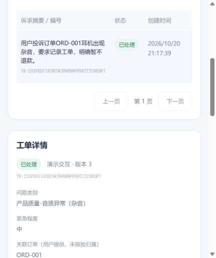
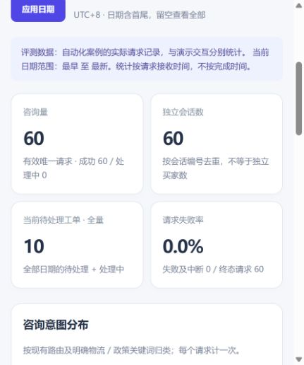

# AI Customer Service Copilot

面向中小电商商家的 AI 客服与运营辅助 MVP，用于 AI 产品经理作品集。

在已有客服原型上，完成 **可靠问答 → 持久化投诉工单 → 商家处理 → 运营数据核对** 的演示闭环。订单、商品和物流来自内置演示资料；工单与指标来自程序实际记录，不代表真实商家经营数据。

## 先看什么

- [产品需求 PRD v1.0](docs/product/PRD_v1.0.md) · [竞品分析](docs/product/COMPETITOR_ANALYSIS_v1.md)
- [业务闭环图](docs/product/business-loop.png) · [关键产品取舍](docs/product/DECISIONS.md)
- [启动指南](docs/QUICKSTART.md) · [演示流程](docs/demo/README.md)
- [评测与证据](docs/evaluation/README.md) · [Sprint 2 交付报告](docs/reports/SPRINT2_REPORT.md)

## 产品问题与实现

| 角色 | 主要需求 | 本项目实现 |
|---|---|---|
| 买家 | 得到有依据的商品、订单、物流和政策回答 | 编号/目录优先、工具参数校验、证据不足时追问或说明范围 |
| 商家客服 | 投诉可追踪，不因刷新丢失 | SQLite 工单、三状态流转、必填处理说明、版本冲突校验与历史记录 |
| 商家运营 | 识别咨询类型、待办和失败请求 | 数据库汇总咨询量、会话数、意图、工单状态、失败率和耗时 |
| 产品负责人 | 判断改进是否有效 | 固定 36 条业务回归、关键重复测试和独立工程测试 |

工单“已保存”不等于已转人工或已通知商家；“已处理”不等于用户满意或退款到账。本项目不执行退款。

## 界面预览




截图来自 2026-10-20 的本机实际运行。右图选择的是评测数据，60 条是 36 条正式回归与 24 次关键重复，不是真实买家咨询量。新安装数据库为空，不预置截图中的统计值。

## 从原型到本项目

基于 [RTY798/ai-customer-service-agent](https://github.com/RTY798/ai-customer-service-agent) 二次开发，上游审计基准为 `9a7888023b5bc64b9bf0ca78ce9e94dc750aec42`。来源与许可说明见 [THIRD_PARTY_NOTICES](THIRD_PARTY_NOTICES.md)。

| 保留的原型基础 | 本轮产品与工程改进 |
|---|---|
| FastAPI、Next.js、五节点 LangGraph 工作流 | 可靠性基线、商品检索/参数校验/关键事实传递与承诺边界修复 |
| DemoDataProvider 及商品/订单/物流查询 | 统一执行服务、SQLite 请求/事件/工单与状态历史 |
| 聊天界面、处理过程和工单对象 | 商家工单管理页、数据库驱动 Dashboard、可复现评测 |

产品工作覆盖需求范围、竞品参考、MVP 优先级、指标口径和验收设计；使用 AI 编程工具辅助代码实现、调试与文档整理，不宣称所有代码均独立手写，也未进行真实商家访谈。现有材料为 PRD v1.0，没有已完成的 Figma 原型或 v1.1 对齐成果。

## 已有验证结果

以下为 **2026-10-17 / 2026-10-20 的历史实测**，原始逐题结果、失败轮次和评分规则均有保留。

| 验证 | 结果 |
|---|---|
| 原版 Baseline 固定规则 | 15/36；其中有 5 条同义表达误判，详见评测说明 |
| Sprint 1 首轮 / 最终 | 35/36 → 36/36 |
| Sprint 2 同集回归 | 36/36；7 张投诉工单实际保存 |
| Sprint 2 关键重复 | 8 条各重复 3 次，24/24 |
| Sprint 2 工程测试 | 47 项通过，和模型效果评分分别统计 |
| 持久化与指标 | 浏览器更新、服务重启、幂等重放及 SQLite 复算通过 |

固定案例由开发者可见，规则不等于完整语义评审。以上不是盲测、生产准确率、客户解决率或商业收益；原始 Baseline 的规则误判与额外回答风险见 [BASELINE_REVIEW](docs/evaluation/BASELINE_REVIEW.json)。

## 启动与使用

按 [QUICKSTART](docs/QUICKSTART.md) 安装依赖、从安全模板创建后端 `.env`，在本地填写自己的模型凭据，再分别启动前后端。

| 页面 | 地址 |
|---|---|
| 买家客服 | http://localhost:3000/ |
| 商家工单 | http://localhost:3000/merchant/tickets |
| 运营概览 | http://localhost:3000/merchant/dashboard |
| API 文档 | http://localhost:8000/docs |

## 技术与范围

FastAPI + 进程内 LangGraph + Next.js/React + SQLite 标准库，兼容 Chat Completions 接口；历史评测使用 GLM。没有增加 Agent、微服务或向量数据库。架构与指标口径见 [ARCHITECTURE](docs/ARCHITECTURE.md)。

当前为本机、单店、单 worker 演示。没有真实电商平台接入、真实退款、实时人工客服、登录鉴权或多店隔离；保留单轮问答边界。未验收云端或 Docker 部署，原审计依赖风险尚需在公网发布前处理。

## 目录

```text
backend/app/         客服、API、SQLite 存储与统计
backend/tests/       独立工程测试
backend/evals/       固定案例、评分器和真实模型运行器
frontend/            买家客服与商家页面
docs/product/        PRD、竞品分析、业务闭环与产品取舍
docs/reports/        审计、可行性与 Sprint 历史报告
docs/evaluation/     精选原始结果、哈希和工程证据
docs/demo/           实际截图和演示步骤
```
