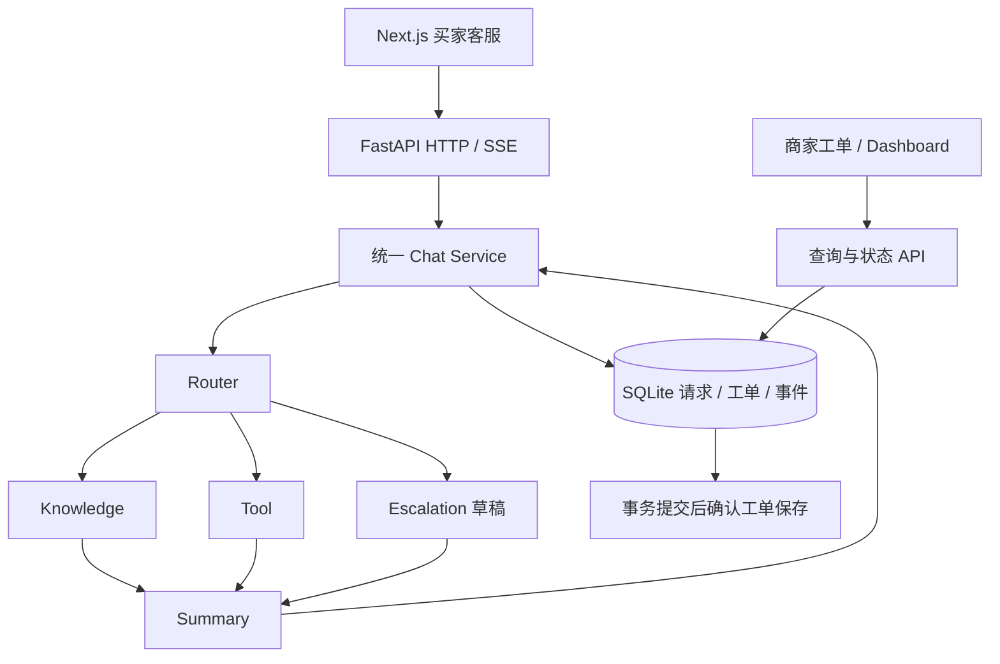

# 架构与统计口径

五个节点仍在同一后端进程内运行。Knowledge 为轻量关键词/编号检索，不是 embedding 向量检索。订单与物流由只读 DemoDataProvider 提供，不是电商平台实时数据。CLI 也使用统一服务；浏览器聊天不是模型多轮记忆。

## 存储

- `chat_turns`：唯一 request_id、conversation_id、来源、问题、执行状态、意图、耗时和成功响应快照。
- `tickets`：程序生成 UUID、来源请求唯一关联、原话、用户提供订单编号、草稿、状态、说明、版本及时间。
- `events`：请求接收/终态、工具调用摘要、工单创建与状态变更。

工单创建、请求成功与相关事件同事务提交后才返回保存确认。状态按 open → in_progress → resolved；完成说明必填，旧版本更新返回 409，重开需原因。SQLite 独立短连接、外键、busy timeout；模型执行期间不持有写事务。

## Dashboard 定义

| 指标 | 口径 |
|---|---|
| 咨询量 | 所选接收日期内有效唯一 request_id，重放不新增 |
| 会话数 | 唯一 conversation_id，不等于独立客户人数 |
| 意图 | 沿用 Agent 路由，订单类按明确物流关键词细分；general 中政策关键词细分；未分类为 unknown |
| 期间工单状态 | 按创建日期过滤工单，再显示其当前状态 |
| 全量待处理 | 当前来源全部日期 open + in_progress |
| 失败率 | failed + interrupted 除以终态请求；processing 不进分母；无终态返回 null |
| 耗时 | 成功/失败分别统计有耗时样本的中位数，未知耗时不补 0 |

UTC 存储、UTC+8 日期含首尾筛选。demo/evaluation 为分析来源标签，不是权限隔离。存储接受请求前的错误无法记入同一故障数据库。SSE 回放处理步骤，未声称逐 token 真流式。完整接口见运行后的 `/docs`。
